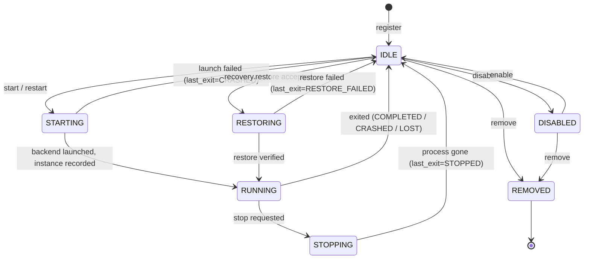
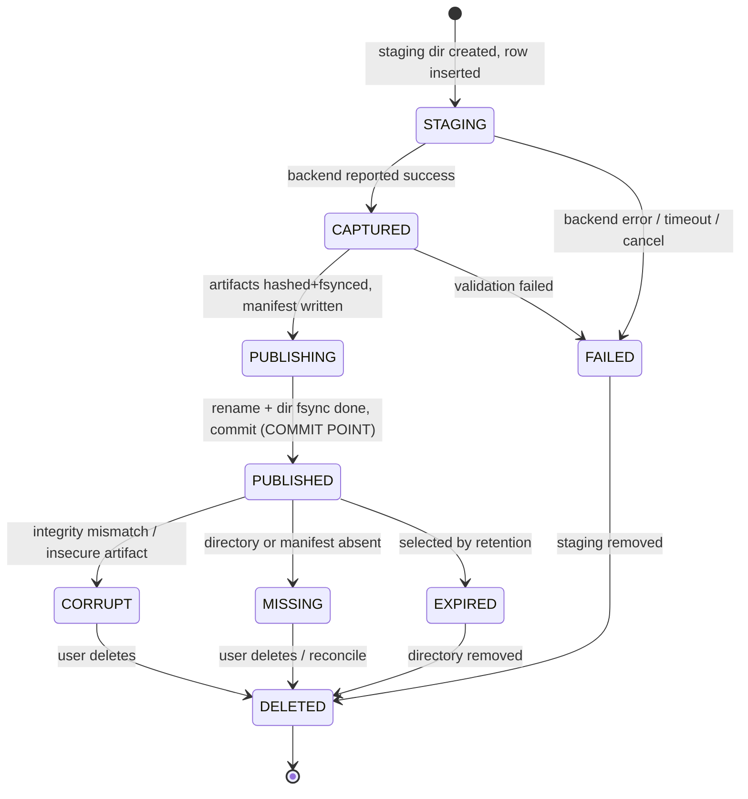
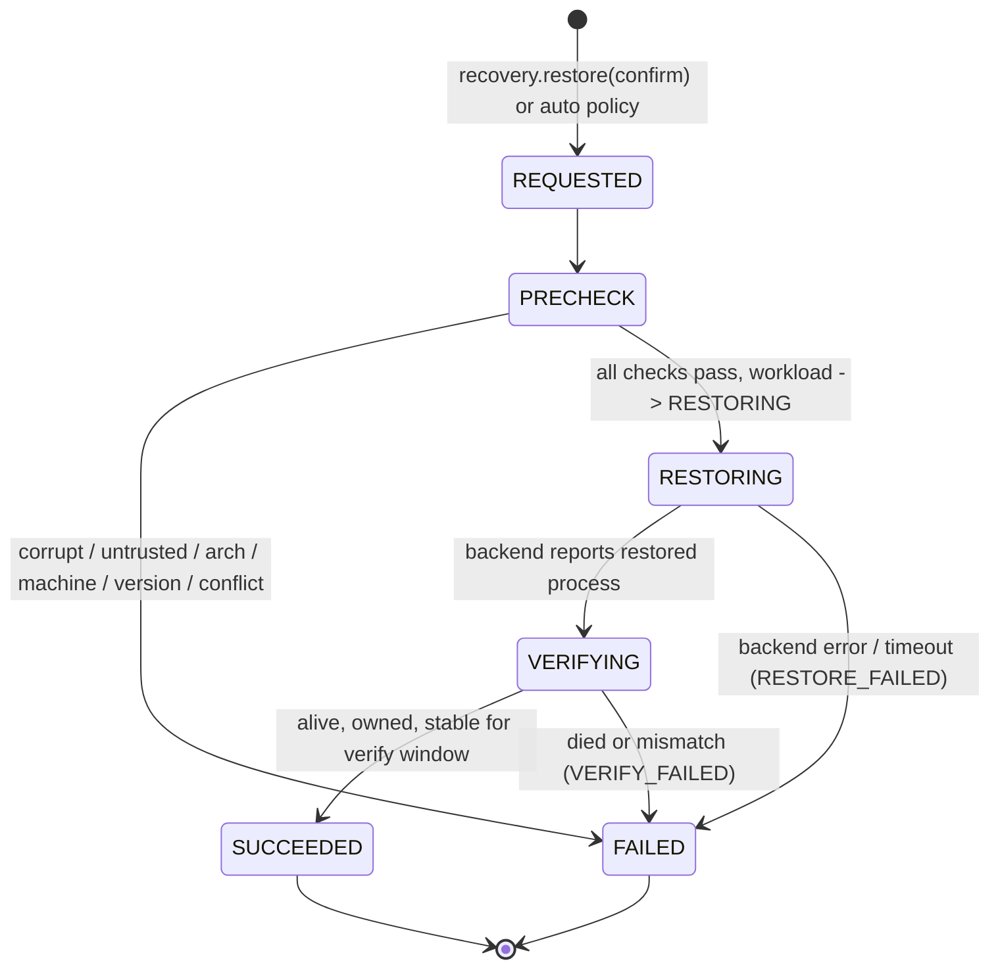
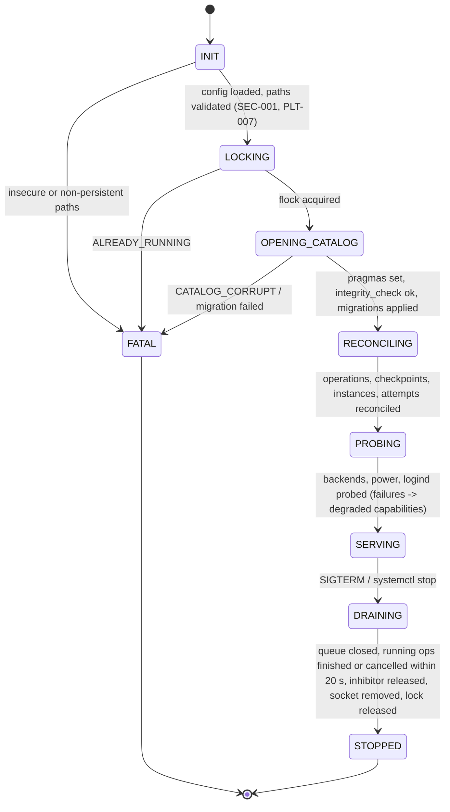

# NapGuard Data and State Models

- Status: Stage 01 design. No database is implemented; the schema is created in Stage 04.
- Related: [components](components.md), [storage and recovery](storage-recovery.md), [requirements](../requirements/requirements.md)

## Conventions

- Identifiers are random UUIDs (version 4) stored as lowercase text. `SystemEvent` is the exception: it uses an integer sequence.
- Timestamps are UTC ISO 8601 text with millisecond precision. Durations are integer milliseconds from a monotonic clock (NFR-008).
- Enumerations are stored as uppercase text and enforced with `CHECK` constraints.
- JSON columns hold validated, size-limited JSON (at most 64 KiB unless stated otherwise).
- Every table has `created_at`. Mutable tables also have `updated_at`.
- Foreign keys are enforced (`PRAGMA foreign_keys=ON`). Deleting rows that have dependents is restricted. Workloads are soft-deleted (`state = REMOVED`) so history stays intact.

## Entities

### Workload

| Field | Type | Constraints |
|---|---|---|
| `workload_id` | UUID | primary key, never reused |
| `name` | text | unique among non-removed workloads, 1–64 characters, `[A-Za-z0-9 ._-]` |
| `executable` | text | absolute, normalized, at most 4096 bytes (FR-002) |
| `argv` | JSON array of strings | at most 256 items, each at most 4096 bytes, no NUL |
| `working_dir` | text | absolute existing directory |
| `env_policy` | JSON | `{"mode": "ALLOWLIST", "pass": [names], "set": {name: value}}`, at most 64 entries (SEC-008) |
| `backend_preference` | enum | `AUTO`, `DMTCP`, `CRIU` |
| `compatibility_status` | enum | `UNKNOWN`, `UNSUPPORTED`, `CANDIDATE`, `VERIFIED` (FR-005) |
| `compatibility_reasons` | JSON array | reason codes |
| `compatibility_backend` | text | the backend name and version the status refers to |
| `compatibility_checked_at` | timestamp | nullable |
| `state` | enum | the workload lifecycle state (below) |
| `last_exit` | enum | `NONE`, `COMPLETED`, `STOPPED`, `CRASHED`, `LOST`, `RESTORE_FAILED` |
| `config_version` | integer | at least 1, incremented on every update (optimistic concurrency) |
| `created_at`, `updated_at` | timestamp | |

### ProtectionPolicy (one per Workload)

| Field | Type | Constraints |
|---|---|---|
| `workload_id` | UUID | primary key, foreign key to `Workload` |
| `enabled` | bool | default false |
| `interval_s` | integer | null (no periodic checkpoints) or at least 60 (FR-013) |
| `battery_low_pct` | integer | null or 5–95, default 20 |
| `battery_critical_pct` | integer | null or 1–`battery_low_pct` − 1, default 10 |
| `battery_hysteresis_pct` | integer | 1–20, default 5 |
| `pre_suspend` | bool | default true |
| `priority` | integer | 0–9, default 5 (higher runs first among equal triggers) |
| `retention_count` | integer | 1–20, default 3 (REL-011) |
| `quota_bytes` | integer | null (global quota only) or at least 1 MiB |
| `auto_recover` | bool | default false (FR-024) |
| `verify_window_s` | integer | 1–300, default 10 (FR-026) |
| `acknowledge_unverified` | bool | must be true to enable protection while compatibility is `UNKNOWN` (CMP-003) |
| `updated_at` | timestamp | |

### ProcessInstance

| Field | Type | Constraints |
|---|---|---|
| `instance_id` | UUID | primary key |
| `workload_id` | UUID | foreign key |
| `origin` | enum | `LAUNCH`, `RESTORE` (FR-028) |
| `restored_from` | UUID | foreign key to `Checkpoint`. Required when `origin = RESTORE`, otherwise null |
| `backend` | text | name and version |
| `backend_session` | JSON | backend-specific session data, such as the DMTCP coordinator port or the CRIU image directory |
| `pid` | integer | the root process of the managed tree, greater than 1 |
| `pid_start_time` | integer | field 22 of `/proc/<pid>/stat`, in clock ticks since boot (SEC-003) |
| `boot_id` | text | `/proc/sys/kernel/random/boot_id` at launch |
| `scope_unit` | text | nullable, the systemd scope name if OD-03 adopts scopes |
| `started_at`, `ended_at` | timestamp | `ended_at` is null while active |
| `end_class` | enum | null, `COMPLETED`, `STOPPED`, `CRASHED`, `LOST` |
| `exit_code`, `exit_signal` | integer | nullable |

Constraint: **at most one active instance per workload**, enforced by a partial unique index on `(workload_id) WHERE ended_at IS NULL` (FR-025).

### Checkpoint

| Field | Type | Constraints |
|---|---|---|
| `checkpoint_id` | UUID | primary key |
| `workload_id` | UUID | foreign key |
| `instance_id` | UUID | foreign key, the instance that was captured |
| `operation_id` | UUID | foreign key, unique |
| `generation` | integer | at least 1, unique per `(workload_id, generation)`, strictly increasing |
| `state` | enum | the checkpoint lifecycle state (below) |
| `trigger` | enum | `MANUAL`, `PERIODIC`, `LOW_BATTERY`, `CRITICAL_BATTERY`, `PRE_SUSPEND` |
| `backend`, `backend_version` | text | CMP-004 |
| `arch`, `kernel_release`, `boot_id`, `machine_id_sha256` | text | CMP-005, EXC-010 |
| `relative_dir` | text | relative to the checkpoints root; set once the checkpoint is `PUBLISHING` |
| `manifest_sha256` | text | digest of the published `manifest.json` (SEC-007) |
| `total_bytes`, `artifact_count` | integer | PRF-002 |
| `capture_ms`, `validate_ms` | integer | PRF-001 |
| `integrity_checked_at`, `integrity_result` | timestamp, enum | `OK`, `MISMATCH`, `MISSING`, `INSECURE` |
| `restore_verified_at` | timestamp | nullable; set by a `SUCCEEDED` RecoveryAttempt |
| `created_at`, `published_at` | timestamp | |

### CheckpointOperation

| Field | Type | Constraints |
|---|---|---|
| `operation_id` | UUID | primary key |
| `workload_id` | UUID | foreign key |
| `trigger` | enum | as for `Checkpoint` |
| `priority_class` | integer | derived from the trigger (FR-016) |
| `state` | enum | `QUEUED`, `RUNNING`, `SUCCEEDED`, `FAILED`, `TIMED_OUT`, `CANCELLED`, `INTERRUPTED` |
| `requested_by` | text | `scheduler`, or `ipc:uid=<uid>` |
| `requested_at`, `started_at`, `finished_at`, `deadline_at` | timestamp | |
| `duration_ms` | integer | set at the terminal state |
| `checkpoint_id` | UUID | nullable; set on `SUCCEEDED` |
| `error_code`, `error_detail` | text | at most 4 KiB of detail |

Constraint: **at most one queued or running operation per workload**, enforced by a partial unique index on `(workload_id) WHERE state IN ('QUEUED','RUNNING')` (FR-014).

### RecoveryAttempt

| Field | Type | Constraints |
|---|---|---|
| `attempt_id` | UUID | primary key |
| `workload_id`, `checkpoint_id` | UUID | foreign keys |
| `mode` | enum | `USER_CONFIRMED`, `AUTO` |
| `state` | enum | the recovery lifecycle state (below) |
| `boot_id` | text | the boot in which the attempt ran (FR-024: once per checkpoint per boot) |
| `resulting_instance_id` | UUID | nullable, foreign key to `ProcessInstance` |
| `verification` | JSON | the observed process facts and window result |
| `requested_at`, `finished_at` | timestamp | |
| `duration_ms` | integer | PRF-003 |
| `error_code`, `error_detail` | text | |

Constraints:

- At most one active attempt per workload: a partial unique index on `(workload_id) WHERE state NOT IN ('SUCCEEDED','FAILED','INTERRUPTED')` (FR-025).
- A unique index on `(checkpoint_id, boot_id) WHERE mode = 'AUTO'`, so auto-recovery runs at most once per checkpoint per boot (FR-024).

### SystemEvent

| Field | Type | Constraints |
|---|---|---|
| `seq` | integer | primary key, autoincrement |
| `ts` | timestamp | |
| `type` | text | dotted name, for example `checkpoint.published` |
| `category` | enum | `operation`, `process`, `power`, `sleep`, `security`, `storage`, `daemon` |
| `severity` | enum | `DEBUG`, `INFO`, `WARNING`, `ERROR` |
| `source` | text | component key |
| `workload_id`, `operation_id`, `attempt_id` | UUID | nullable |
| `simulated` | bool | true for injected or replayed inputs (UX-005) |
| `data` | JSON | at most 8 KiB; no environment values or full argument arrays |

Events are kept for 30 days or 100,000 rows, whichever is reached first. Pruning deletes the oldest rows.

### Relationships

```text
Workload 1 ── 1 ProtectionPolicy
Workload 1 ── * ProcessInstance ── * Checkpoint (captured from)
Workload 1 ── * CheckpointOperation ── 0..1 Checkpoint (produced)
Workload 1 ── * RecoveryAttempt ── 1 Checkpoint (restored from)
RecoveryAttempt 0..1 ── 1 ProcessInstance (resulting, origin = RESTORE)
SystemEvent * ── 0..1 Workload / CheckpointOperation / RecoveryAttempt
```

## State machines

In every machine below, a transition that is not listed is invalid. The owning component refuses it with `INVALID_STATE` and logs a `WARNING` event. Each transition is a single catalog transaction.

### Workload lifecycle



Checkpointing is not a workload state. A workload stays `RUNNING` while a separate `CheckpointOperation` runs.

Invalid transitions, among others:

| From | To | Refused because |
|---|---|---|
| `RUNNING`, `STARTING`, `STOPPING` | `RESTORING` | duplicate process (FR-025) |
| `RESTORING` | `STARTING` | the restore must finish first |
| `RUNNING`, `STARTING`, `RESTORING` | `REMOVED` | the workload is active (FR-003) |
| `DISABLED` | `STARTING`, `RESTORING` | it must be enabled first |
| `REMOVED` | anything | terminal |

Crash recovery happens in daemon `RECONCILING`, for every workload in `STARTING`, `RUNNING`, `STOPPING`, or `RESTORING`:

1. Load the active `ProcessInstance`.
2. If the boot ID differs from the current boot, the instance is lost: end the instance with `LOST`, and set the workload to `IDLE` with `last_exit=LOST`.
3. Otherwise, check the process with `pidfd_open(pid)` and compare `pid_start_time` and the UID. If all match, the workload is `RUNNING` and it is re-adopted. If not, it is `LOST`, as in step 2.
4. A workload left in `RESTORING` resolves together with its `RecoveryAttempt` (see the recovery lifecycle below).

### Checkpoint lifecycle

`CheckpointOperation` tracks the job. `Checkpoint` tracks the artifact.



- Only `PUBLISHED` checkpoints are ever advertised or restorable (REL-001).
- `restore_verified_at` is a separate attribute, not a state: a checksum match does not prove a checkpoint is restorable.

Invalid transitions:

| From | To | Refused because |
|---|---|---|
| `STAGING`, `CAPTURED` | `PUBLISHED` | validation and publication must not be skipped |
| `FAILED`, `CORRUPT`, `MISSING`, `EXPIRED` | `PUBLISHED` | it was never valid, or no longer is |
| `DELETED` | anything | terminal |
| `PUBLISHED` | `DELETED` | retention must mark it `EXPIRED` first, and must never remove the last `PUBLISHED` checkpoint (REL-010, REL-011) |

Crash recovery, also in `RECONCILING`:

- `STAGING` or `CAPTURED`: becomes `FAILED` with reason `INTERRUPTED`. The staging directory is removed and the operation is marked `INTERRUPTED` (REL-009).
- `PUBLISHING`: the outcome depends on the disk ([storage design](storage-recovery.md#atomic-publication-protocol)).
  - If the final directory exists and its manifest and hashes verify, the checkpoint rolls forward to `PUBLISHED`.
  - If only the staging directory exists, it becomes `FAILED` and the staging directory is removed.
  - If neither exists, it becomes `FAILED`.
- `PUBLISHED` without a directory becomes `MISSING`.

`CheckpointOperation` states:

- `QUEUED → RUNNING`
- `RUNNING → SUCCEEDED | FAILED | TIMED_OUT | CANCELLED`
- `QUEUED → CANCELLED`
- `QUEUED | RUNNING → INTERRUPTED`, only during startup reconciliation
- The terminal states are final.

### Recovery lifecycle



The `PRECHECK` stage runs these checks:

1. The checkpoint is `PUBLISHED`, and its manifest digest matches the catalog (SEC-007).
2. Artifact hashes, ownership, and modes are valid (REL-006, SEC-006).
3. The architecture and machine ID match (CMP-005, EXC-010).
4. The backend is available and its version is compatible (CMP-004).
5. The workload has no active instance and no other active attempt (FR-025).
6. Free space and resources are sufficient for the backend restore.

Rules:

- `SUCCEEDED`, `FAILED`, and `INTERRUPTED` are terminal.
- A second active attempt for the same workload is refused by the partial unique index.
- A `FAILED` attempt never changes the checkpoint's state, except to `CORRUPT` when the precheck found an integrity failure (FR-027).

Crash recovery: an attempt found in `REQUESTED`, `PRECHECK`, `RESTORING`, or `VERIFYING` becomes `INTERRUPTED`.

- If a process recorded by the backend session is alive and its identity matches, the supervisor adopts it as a `RESTORE` instance. The adoption is logged, and the user must confirm it is healthy.
- Otherwise the workload returns to `IDLE` with `last_exit=RESTORE_FAILED`.
- An interrupted attempt is never retried automatically.

### Daemon startup and shutdown



- The socket starts listening only in `SERVING`, so clients never see state that has not been reconciled.
- When `PROBING` finds a capability missing, the daemon degrades instead of failing. It reports `backend: unavailable`, `battery: absent`, or `sleep: unavailable`, and the related features are disabled (PLT-004, PKG-005).
- `DRAINING` never kills managed workloads; they keep running in their own scopes (OD-03, FR-030). An operation still running after the drain deadline is cancelled if the backend supports it. Otherwise it is left to become `INTERRUPTED` at the next startup.
- An exit from `FATAL` uses a distinct exit code (see [components](components.md#daemon-service-core-daemon)) and never modifies the catalog.
